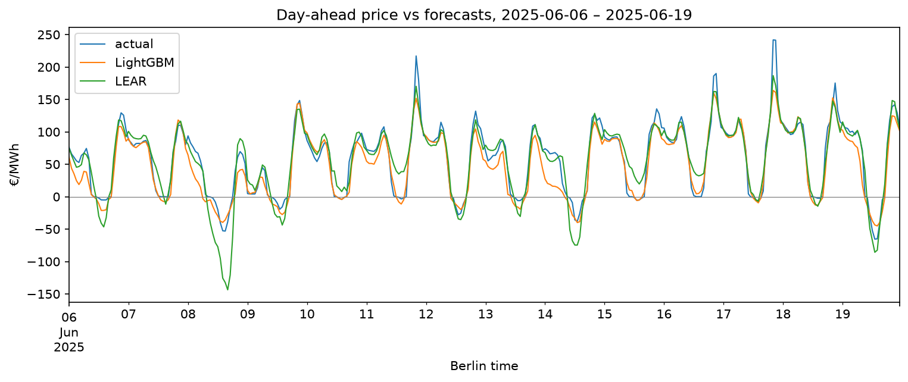
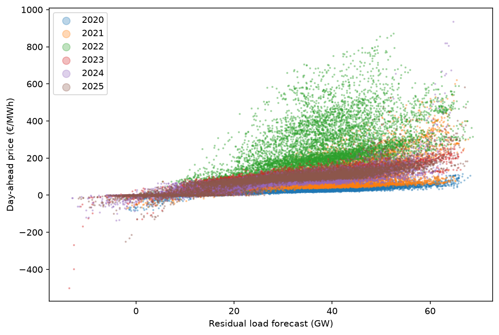

# Day-Ahead Price Forecasting - Germany (DE-LU)

Forecasting hourly German day-ahead electricity prices from information available
at auction gate closure (noon, D-1), comparing a statistical benchmark (LEAR)
with gradient boosting (LightGBM).

**Result (test year 2025, run once):** LightGBM with weekly retraining reaches an MAE of
**11.5 €/MWh**, 58% lower than a naive benchmark (rMAE 0.42). Performance was stable
between validation (2024: rMAE 0.43) and test.



**Dashboard:** [explore any day of the 2025 forecasts in a Streamlit app](https://energy-portfolio-richa.streamlit.app/)
(`streamlit run 01-price-forecasting/app/app.py` from the repository root).

## Results

| Model | MAE 2024 (val) | MAE 2025 (test) | rMAE 2025 | Negative-price recall / precision 2025 |
|---|---|---|---|---|
| Naive (Lago et al.) | 27.3 | 27.5 | 1.00 | 0.53 / 0.54 |
| LEAR (window average) | 12.7 | 12.3 | 0.45 | 0.66 / 0.83 |
| **LightGBM (weekly)** | **11.7** | **11.5** | **0.42** | **0.76 / 0.77** |
| Average of both* | 11.1 | 10.9 | 0.40 | 0.70 / 0.85 |

MAE in €/MWh. rMAE = MAE relative to the naive benchmark.
*Added after the 2024 error analysis and declared before the test; reported alongside, not selected.

## How the price forms, and what the model uses

The day-ahead price is set by the most expensive plant needed to meet demand.
Two quantities determine it:

- **How far along the merit order the market reaches:** forecast residual load
  (load minus wind and solar).
- **How expensive those plants are:** gas and coal plant marginal costs,
  built from TTF gas, API2 coal and EU carbon prices.



Each year forms its own band: residual load sets the position along the curve,
fuel and carbon prices set its height. Their interaction (residual load × gas plant
marginal cost) carried the most gain in LightGBM (22%, monthly model, December 2024).

## Data

| Input | Source | Known at noon D-1 as |
|---|---|---|
| Day-ahead prices | ENTSO-E | Prices of D-1 and earlier |
| Load, wind, solar | ENTSO-E | Day-ahead forecasts (never actuals) |
| Gas (TTF), coal (API2) | Yahoo Finance, front-month | Last settlement on or before D-2 |
| Carbon (EUA) | EEX primary auctions | Last auction on or before D-2 |
| Temperature (optional) | Open-Meteo Previous Runs (GFS, day-2) | Forecast issued ~48 h ahead |

2020-2025, hourly, UTC. The quarter-hourly market since October 2025 is averaged to hourly.

**Leakage rules:** forecasts only for weather-dependent inputs; no same-day price lags;
fuel prices lagged to the last settlement before the auction; lags built on German
wall-clock time so clock changes don't shift them; transformation parameters fitted
on each training window only; splits by time, never shuffled.

## Models

- **Naive benchmark** (Lago et al., 2021): same hour of the previous day, or of the
  previous week for Mondays and weekends.
- **LEAR:** one LASSO model per hour, asinh-transformed prices, recalibrated daily;
  average of 365, 730 and 1095 day training windows.
- **LightGBM:** one model for all hours, L1 loss, 730 day window, retrained weekly.

## Evaluation

Train 2020-2023, validate 2024, test 2025. All choices were made on 2024 with
experiments and a decision rule written down before running them; the test
protocol was committed before the 2025 run. Metrics: MAE, RMSE, bias, rMAE, and
negative-price recall and precision, reported for all hours and for negative-price,
low-residual-load and evening-peak hours. MAPE is not used, since it is undefined
or misleading for prices near or below zero.

## Findings

1. **Stable performance:** rMAE 0.43 -> 0.42 (LightGBM) and 0.47 -> 0.45 (LEAR)
   from validation to test.
2. **LEAR overshoots below zero.** Likely because its linear structure extends the
   downward trend, while actual negative prices cluster just below zero. In 2025's
   negative-price hours: 244 forecasts below -20 €/MWh against 84 actual hours.
3. **Both models under-forecast the evening ramp** (17-20h bias: LightGBM -5.7, LEAR
   -2.2 €/MWh). For LightGBM, partly because L1 loss targets the median of
   right-skewed prices.
4. **Scarcity spikes are missed.** Above 60 GW residual load (0.7% of 2024 hours),
   errors average ~150 €/MWh and make up ~10% of total error.
5. **The negative-price trade-off is not stable:** in 2024 LEAR caught more negative
   hours; in 2025 LightGBM did. Which model suits a user depends on whether missing
   negative hours or false alarms costs more.

Longer-run price trends and autocorrelation are analysed in the earlier exploration
[de-power-price-analysis](https://github.com/1412richa/de-power-price-analysis),
included here as a submodule.

## Limitations

- Scarcity price spikes are systematically under-forecast.
- No actual wind/solar data, so input forecast errors can't be separated from model errors.
- Hourly resolution; the 15-minute market is not modelled.
- Free front-month fuel prices are proxies for what plants actually pay;
  the German gas hub (THE) traded at a premium to TTF in 2022.
- Weather data is lower quality than professional forecasters use.

## Reproduce

From the repository root (the requirements file installs this project as a package):

```
python -m venv .venv && source .venv/bin/activate   # Windows: .venv\Scripts\activate
pip install -r requirements.txt
# ENTSOE_API_KEY in .env (repository root)
```

Run in order: `fetch_prices.py`, `fetch_fundamentals.py`, `fetch_weather.py`,
`fetch_fuels.py`, `build_base.py`, `validate_base.py`, `build_features.py`,
`run_baselines.py`, `LEAR.py`, `lightgbm_model.py`, `error_analysis.py`, `test_report.py`.

- **Gas prices:** Yahoo Finance no longer serves the full `TTF=F` history, so
  `data/raw/fuels/ttf.csv` must be restored from a backup; `fetch_fuels.py` stops with
  an error rather than save a partial series. EEX auction files are downloaded automatically.
- **Run time:** the 2024 experiments in `LEAR.py` and `lightgbm_model.py` take about
  two hours in total. Their final-test cells were run once, on 2025; re-running them is
  only needed to reproduce the test.
- **Figures:** scripts save to `reports/figures/` (not tracked); the ones shown here
  are copies in `docs/figures/`.
- **Dashboard:** `app/export_app_data.py` writes the test forecasts and metrics to
  `app/data/` (tracked, so the app runs without the pipeline). The app only needs
  `app/requirements.txt`.

Design notes: `notes/features.md`, `notes/evaluation.md`, `notes/results_log.md`.